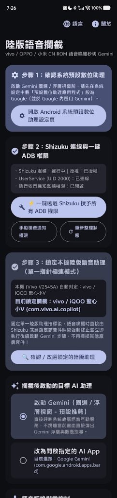
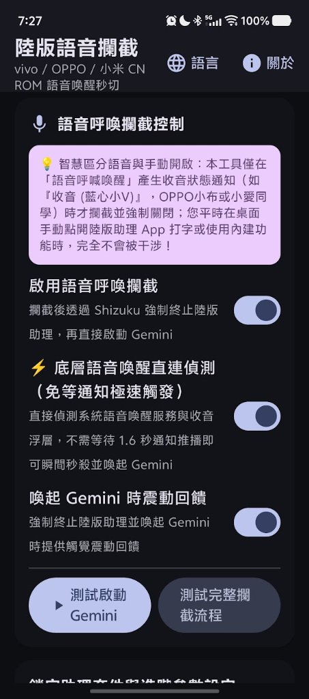
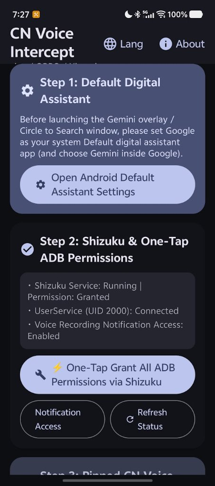
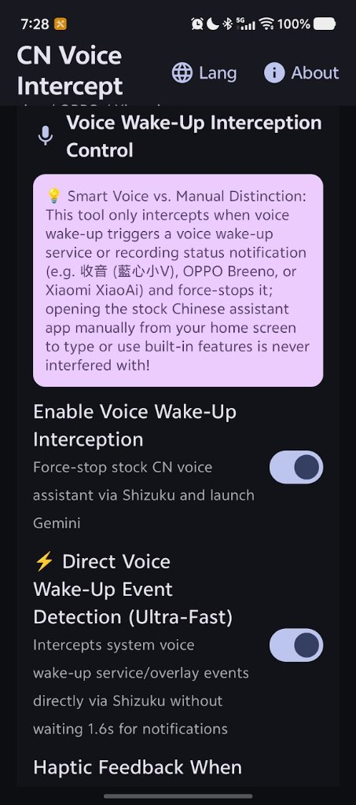

# CnVoiceIntercept（陸版語音呼喚攔截）

[繁體中文](#繁體中文說明) | [English](#english-description)

> **📢 專案停更與使用到期公告 / End-of-Life & Expiration Notice**
> - **使用到期日**：本專案最終版（`v1.5.1`）僅可使用至 **2026-12-01**（台灣時間 `2026-12-02 00:00` 起停止運作），**使用到期日後將從 GitHub Releases 移除 APK 檔案**。
> - **整合功能新儲存庫**：本工具功能已全面整合至全新專案 👉 **[Android-CN-System-Enhancer](https://github.com/dx9901mk5/Android-CN-System-Enhancer)**，歡迎前往使用！
>
> ---
>
> - **Expiration Date**: The final release (`v1.5.1`) is valid through **2026-12-01** (stops working at **2026-12-02 00:00 UTC+8 / Asia/Taipei**). **The APK will be removed from GitHub Releases after the expiration date.**
> - **Integrated Repository**: All features have been integrated into 👉 **[Android-CN-System-Enhancer](https://github.com/dx9901mk5/Android-CN-System-Enhancer)**. Please use the new repository for future updates!

---

## 繁體中文說明

> **⚠️ 重要說明：免 Root，但必須使用 Shizuku（No Root Required, Shizuku Mandatory）**
> - **完全免 Root**：無需解鎖 Bootloader 或取得手機 Root 權限。
> - **必須搭配 Shizuku**：本 App **必須安裝並啟動 [Shizuku](https://shizuku.rikka.app/) 服務且完成授權**，才能透過系統級權限強制終止陸版語音助理並啟動 Gemini（或自訂 AI 助理）。

### 專案目的
專為 **vivo（OriginOS — 藍心小V）、OPPO / 一加 / Realme（ColorOS — 小布助手）與 小米 / Redmi（HyperOS / MIUI — 小愛同學）陸版（CN ROM）手機與平板** 打造的語音喚醒攔截與 AI 切換工具。

由於陸版 CN ROM 將硬體麥克風底層「語音喚醒詞」（如喊「小V小V」、「小布小布」、「小愛同學」）寫死綁定給系統內建的陸版語音助理，且自 Android 14+ 起傳統的 `android.intent.action.VOICE_COMMAND` 常被陸版系統攔截或失效；本專案讓你**直接沿用陸版系統原生的語音呼喊喚醒**，在喊出喚醒詞的瞬間**透過 Shizuku 攔截並強制終止陸版助理（釋放麥克風），無縫啟動 Google Gemini（或你自選的任何 AI App）**！

### 核心特色
1. **專為 vivo / OPPO / 小米 陸版 CN ROM 打造**：內建三廠牌語音助理套件與收音通知特徵一鍵套用，亦可自由增減。
2. **智慧區分語音與手動開啟（不干涉手動點開使用）**：
   - 本工具僅在「語音呼喊喚醒」產生收音狀態通知（如『收音 (藍心小V)』，OPPO小布或小愛同學）時才攔截並強制關閉；您平時在桌面手動點開陸版助理 App 打字或使用內建功能時，完全不會被干涉！
3. **極速攔截流程（強制終止 → 啟動 Gemini 震動回饋）**：
   - 攔截後直接透過 Shizuku 強制終止陸版助理（無須模擬返回鍵），隨後立即喚起 Gemini 並提供觸覺震動回饋。
   - **預設模式（啟動 Gemini）**：直接呼叫系統底層語音互動服務，不跳離當前畫面即可彈出 **Gemini 圈選／浮層對話視窗**。
   - **自訂 AI App 模式**：可在 App 內一鍵切換改為啟動 **ChatGPT、Claude、Perplexity、Microsoft Copilot、豆包、Kimi**，或從**手機已安裝的所有 App 清單中自由挑選**。
4. **置頂「系統預設數位助理」捷徑按鈕**：App 開頭即提供一鍵跳轉 Android 系統「預設數位助理應用程式」設定頁的捷徑。
5. **⚡ 一鍵透過 Shizuku 授予所有 ADB 權限**：自動授予通知監聽（`allow_listener`）、解除側載受限設定（`ACCESS_RESTRICTED_SETTINGS`）、背景彈出視窗與省電白名單，免接電腦敲指令。
6. **Material Design 3 設計、三語系介面、自動更新檢查與固定簽章**：
   - 支援 **繁體中文、簡體中文、English** 三語系介面（可跟隨系統或於右上角一鍵切換）與 Material You 動態深淺色主題。
   - 內建 GitHub Releases 更新檢查與系統通知提醒。
   - 採用**固定簽名（Fixed Signature）**，後續下載新版 APK 可直接覆蓋安裝，無需解除安裝舊版。

### 介面截圖（繁體中文）

| 步驟設定與單一助理鎖定 | 語音呼喚攔截與極速直連偵測 |
| :---: | :---: |
|  |  |

### 推薦搭配安裝工具（支援 Shizuku 的檔案管理器／安裝器）
陸版 CN ROM（特別是 vivo OriginOS、OPPO ColorOS 與小米 HyperOS）在安裝或更新第三方 APK 時，常會跳出原廠帳號密碼驗證、安全風險掃描或高風險攔截。**強烈建議搭配以下支援 Shizuku 授權安裝的檔案管理器或安裝器**，即可直接繞過陸版系統安裝器限制、一鍵覆蓋更新：

1. **[ZArchiver](https://play.google.com/store/apps/details?id=ru.zdevs.zarchiver)（最推薦的檔案管理器）**
   - **設定方式**：打開 ZArchiver → `設定` → `ROOT` → 將「存取權限類型」設為 **`Shizuku`**，並勾選「使用 Root 安裝 APK」。
   - **優點**：兼具強大壓縮／檔案管理功能，點選下載好的 APK 即可透過 Shizuku 秒速靜默安裝與覆蓋更新，完全不跳陸版系統帳號驗證視窗。
2. **[InstallerX Revived](https://github.com/wxxsfxyzm/InstallerX-Revived)（開源 Material Design 3 專用安裝器）**
   - **優點**：專為繞過 HyperOS / OriginOS / ColorOS 陸版安裝審核設計，支援透過 Shizuku 替換系統安裝流程。
3. **[MT 管理器 (MT Manager)](https://mt2.cn/) / [MiXplorer](https://mixplorer.com/)**
   - **優點**：進階雙視窗檔案管理器，同樣支援於設定中啟用 Shizuku 權限直接安裝 APK。

---

## English Description

> **⚠️ Important: No Root Required, Shizuku Mandatory**
> - **100% Rootless**: No bootloader unlock or root access needed.
> - **Shizuku Required**: You **must install, start, and authorize [Shizuku](https://shizuku.rikka.app/)** so `CnVoiceIntercept` can force-stop the built-in Chinese voice assistant and launch Gemini or your chosen AI app from the background.

### Purpose
A dedicated voice wake-up interceptor built for **vivo (OriginOS — BlueLM Copilot / Jovi), OPPO / OnePlus / Realme (ColorOS — Breeno), and Xiaomi / Redmi (HyperOS / MIUI — XiaoAi) Mainland China (CN) ROM phones and tablets**.

On Chinese ROMs, hardware hotword detection ("XiaoV", "XiaoBu", "XiaoAi") is hardcoded to the stock Chinese voice assistant, and standard `android.intent.action.VOICE_COMMAND` intents are often blocked or broken on Android 14+. **`CnVoiceIntercept` intercepts the stock assistant the instant you trigger it by voice, force-stops it via Shizuku to free the microphone immediately, and launches Google Gemini (or any AI app you choose)!**

### Key Features
1. **Built for vivo, OPPO, and Xiaomi CN ROMs**: Includes one-tap presets for vivo, OPPO, and Xiaomi voice assistant packages and voice-recording notification keywords.
2. **Smart Voice vs. Manual Distinction — Never Interferes with Manual App Usage**:
   - Triggers **only** when a voice wake-up recording notification (e.g., `收音 (藍心小V)`, OPPO Breeno, or Xiaomi XiaoAi) appears.
   - **Opening the stock Chinese assistant manually by tapping its app icon on your home screen to type or use built-in features works normally without interference!**
3. **Direct Force-Stop → Launch Gemini with Haptic Feedback + Custom AI App Picker**:
   - **Default Mode (Launch Gemini)**: Directly invokes the system voice interaction session via Binder to summon the **Gemini overlay / Circle to Search window** over your current screen with haptic click feedback.
   - **Custom AI App Mode**: Easily switch to launch **ChatGPT, Claude, Perplexity, Microsoft Copilot, Doubao, Kimi**, or **pick any installed app on your device** via the built-in searchable app picker.
4. **Top Shortcut to Android Default Digital Assistant Settings**: One-tap shortcut at the top of the app to open Android's system "Default digital assistant app" settings page.
5. **⚡ One-Tap ADB Permissions via Shizuku**: Automatically grants Notification Listener access (`cmd notification allow_listener`), `ACCESS_RESTRICTED_SETTINGS`, background start permissions, and battery optimization whitelist via Shizuku without needing a PC.
6. **Material Design 3 UI, Trilingual Interface, Update Notifications & Fixed APK Signing**:
   - Full **Traditional Chinese, Simplified Chinese, and English** UI with Material You dynamic dark/light theme support.
   - Built-in GitHub Releases update checker with system notification alerts and an "About Me / GitHub" dialog.
   - Signed with a **fixed cryptographic key** so future updates install directly over existing versions without uninstalling.

### App Screenshots (English)

| Setup Steps & Pinned Assistant | Voice Interception & Direct Wake-Up Control |
| :---: | :---: |
|  |  |

### Recommended Shizuku-Powered File Managers / Installers
Chinese ROMs (OriginOS, ColorOS, HyperOS) frequently show account password prompts or security blocks when sideloading or updating APKs. **We strongly recommend installing and updating APKs using a Shizuku-compatible file manager or package installer**:

1. **[ZArchiver](https://play.google.com/store/apps/details?id=ru.zdevs.zarchiver) (Top Recommended File Manager)**
   - **Setup**: Open ZArchiver → `Settings` → `ROOT` → Set type of root access to **`Shizuku`** and enable `Use for install APK`.
   - **Why**: Lets you browse and install/update APKs directly via Shizuku in one tap, bypassing CN ROM account verification popups completely.
2. **[InstallerX Revived](https://github.com/wxxsfxyzm/InstallerX-Revived) (Open-Source Material 3 Shizuku Installer)**
   - **Why**: Specifically designed to bypass CN ROM package installer restrictions on HyperOS, OriginOS, and ColorOS using Shizuku.
3. **[MT Manager](https://mt2.cn/) / [MiXplorer](https://mixplorer.com/)**
   - **Why**: Power-user dual-pane file managers with native Shizuku APK installation support.
